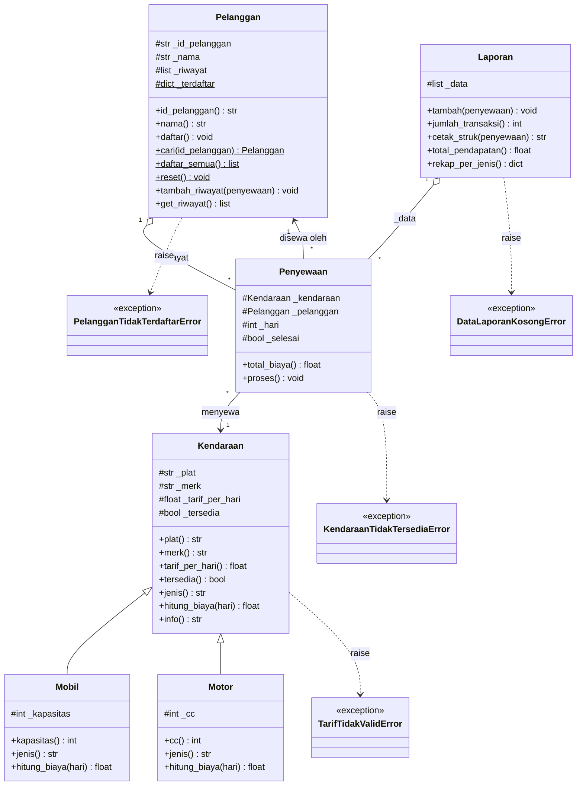

# Desain Sistem Rental Kendaraan

Pertemuan 11 - Milestone Desain (Tugas Besar PBO, INF2516)

**Tema:** Sistem Rental Kendaraan (sewa mobil dan motor)

## 1. Kebutuhan Sistem

### Kebutuhan fungsional

| Kode | Kebutuhan | Class pemegang |
|---|---|---|
| F-01 | Melihat daftar kendaraan beserta status (Tersedia/Disewa) | `Kendaraan` |
| F-02 | Mendaftarkan pelanggan baru (ID unik, ID dan nama tidak boleh kosong) | `Pelanggan` |
| F-03 | Memproses sewa: cek pelanggan terdaftar, cek kendaraan tersedia, durasi bilangan bulat > 0 | `Penyewaan` |
| F-04 | Menghitung biaya sesuai jenis: Mobil + asuransi 5%, Motor diskon 10% jika sewa 7 hari atau lebih | `Mobil`, `Motor` |
| F-05 | Mencetak struk transaksi | `Laporan` |
| F-06 | Mengembalikan kendaraan yang disewa | `Kendaraan` |
| F-07 | Menampilkan jumlah transaksi, total pendapatan, dan rekap per jenis | `Laporan` |
| F-08 | Menyimpan riwayat sewa tiap pelanggan | `Pelanggan` |

### Kebutuhan non-fungsional

- Satu anggota bertanggung jawab atas satu class utama.
- Dua antarmuka: konsol dan web (Streamlit).
- Input tidak valid ditangani dengan custom exception.
- Setiap class diuji dengan `unittest`.

## 2. Pembagian Class

| Anggota | Nama | Class |
|---|---|---|
| A | Imam Taufiq N | Laporan |
| B | Gulam Nuzul Kautsar | Penyewaan |
| C | Reyhan Mochamad Ikhbal | Pelanggan |
| D | Firgiawan Zhaliam | Kendaraan, Mobil, Motor |

`Mobil` dan `Motor` adalah turunan `Kendaraan` (satu hierarki inheritance), sehingga dihitung sebagai satu kesatuan class utama.

## 3. Class Diagram

### Keterangan notasi

- `#` = protected (konvensi satu underscore), `+` = public, `$` = milik class (static).
- `<|--` inheritance, `-->` association, `o--` aggregation, `..>` dependensi exception.
